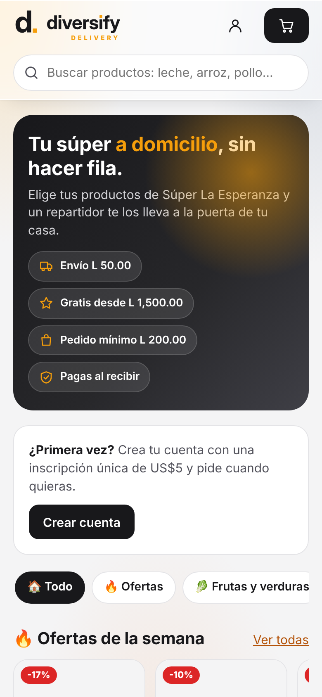

# Diversify Delivery

Tienda en línea y pedidos a domicilio para supermercados, conectada a **Diversify POS**.
Desarrolla **PolyMorpha** (San Pedro Sula).

| Quién | Dónde entra | Qué hace |
|---|---|---|
| **Cliente final** | `https://delivery.diversify.hn/` | Ve el catálogo sin cuenta. Se registra, paga una **inscripción única de US$5** (tarjeta con **PixelPay** o transferencia) y hace pedidos con dirección, ubicación GPS e instrucciones. Sigue su pedido en vivo. |
| **Master** (administrador) | `/panel/` | Sube productos y fotos, cambia precios (uno por uno o por porcentaje), atiende pedidos en un tablero, asigna repartidores, aprueba inscripciones y configura la tienda. |
| **Repartidor** | `/repartidor/` (celular) | Toma pedidos, ve instrucciones, referencias y ubicación, abre Google Maps o Waze, llama o escribe por WhatsApp al cliente y confirma la entrega con el código del cliente. |

Boceto con capturas y todas las funciones: **[docs/FUNCIONALIDADES.md](docs/FUNCIONALIDADES.md)**.



## Ramas

| Rama | Uso |
|---|---|
| `master` | **Lo publicado.** Solo recibe cambios ya probados en `beta`. `deploy/publicar.sh` desde `master` actualiza el contenedor de **producción**. |
| `beta` | **Cambios pendientes de probar.** El trabajo nuevo se hace aquí (o en ramas que salen de aquí). `deploy/publicar.sh` desde `beta` actualiza el contenedor de **pruebas** (opcional). |

Flujo: rama de trabajo → `beta` → se prueba → merge de `beta` a `master` → publicar.

## Stack

Igual que Diversify POS, para que el mismo equipo mantenga los dos:

- **Backend:** ASP.NET Core 10 (Minimal APIs), EF Core + SQLite (`data/delivery.db`), cookies de sesión.
- **Frontend:** HTML + CSS + JavaScript ES modules **sin build** ni dependencias externas (CSP estricta). Diseño
  "Liquid Glass" con la identidad de Diversify (tinta `#18181B`, ámbar `#F59E0B`), claro y oscuro.
- **Servidor:** contenedor LXC **propio** en Proxmox (aparte del de Diversify POS), Caddy, systemd, nftables,
  fail2ban, respaldo diario y Cloudflare Tunnel opcional.

## Correr en desarrollo

```bash
dotnet run --project src/Diversify.Delivery --launch-profile http
```

Abre http://localhost:5390. Datos de demostración (negocio ficticio "Súper La Esperanza"):

| Rol | Usuario | Contraseña |
|---|---|---|
| Master | `master` | `master123` |
| Repartidor | `repartidor` / `repartidor2` | `repartidor123` |
| Cliente activo | `cliente@demo.hn` | `cliente123` |
| Cliente con transferencia en revisión | `ana@demo.hn` | `cliente123` |

El cobro con tarjeta usa **PixelPay** ([docs/PIXELPAY.md](docs/PIXELPAY.md)). Sin PixelPay configurado, en
desarrollo hay una pasarela **simulada** (`Payments:Simulated=true`) que aprueba sin cobrar. Para probar con el
sandbox de PixelPay: `PixelPay__Sandbox=true`. En producción la app no arranca con la simulada ni con el sandbox.

Para empezar con base limpia: borra `src/Diversify.Delivery/data/`.

## Pruebas

```bash
node tests/e2e-capturas.cjs
```

Recorre el flujo completo (registro → inscripción → carrito → pedido con GPS → master lo arma → repartidor lo
entrega con el código) y guarda las capturas en `docs/capturas/`. `tests/pago-pixelpay.cjs` prueba el cobro con
PixelPay (Hosted Payment) contra un PixelPay simulado. Ver [tests/README.md](tests/README.md).
También: `dotnet build`, `node --check` en cada `.js` y `shellcheck -S warning deploy/*.sh deploy/proxmox/*.sh`
(los corre la integración continua de GitHub en `master` y `beta`).

## Conexión con Diversify POS

Delivery copia de Diversify POS las categorías, productos, precios, existencias y fotos, con un usuario de
**solo consulta** (rol `bodega`). No hay que cambiar nada en Diversify POS. Detalle en
[docs/INTEGRACION-DIVERSIFY.md](docs/INTEGRACION-DIVERSIFY.md).

## Despliegue en Proxmox

Contenedor aparte, mismo esquema que Diversify POS. Guía: [docs/DESPLIEGUE-PROXMOX.md](docs/DESPLIEGUE-PROXMOX.md).

```bash
./deploy/build-release.sh 1.0.0
```

## Estructura

```
src/Diversify.Delivery/
  Program.cs                 arranque: seguridad, sesión, endpoints
  Core/                      entidades, DbContext, seguridad, hosting, datos demo, SchemaUpgrades
  Modules/                   AuthEndpoints, RegistrationEndpoints ($5), CatalogEndpoints, Orders (cliente, master,
                             repartidor), AdminEndpoints, DiversifySync
  wwwroot/
    index.html               tienda (cliente)       js/tienda/*
    panel/index.html         panel (master)         js/panel/*
    repartidor/index.html    app del repartidor     js/repartidor/*
    css/ app.css (tokens y componentes) tienda.css panel.css repartidor.css
    js/ api.js ui.js brand.js
deploy/                      instalación y actualización en el contenedor
docs/                        funcionalidades (boceto), integración, despliegue, capturas
tests/                       recorrido de punta a punta con Playwright
```
