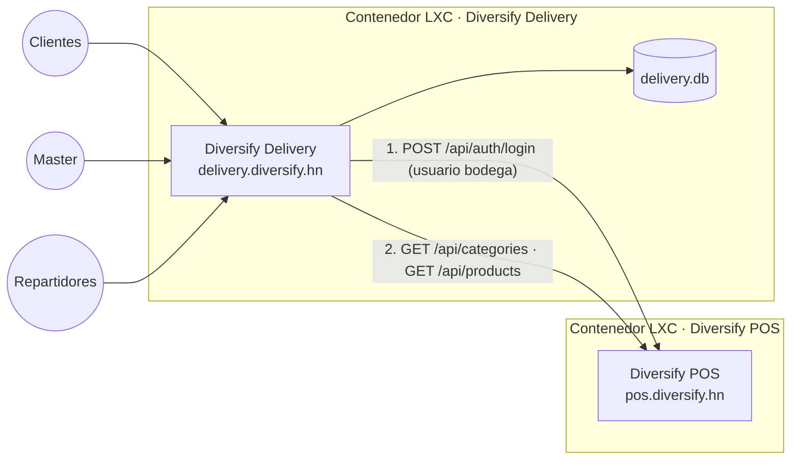

# Integración con Diversify POS

Diversify Delivery **lee** de Diversify POS el catálogo del supermercado. No escribe nada en el POS.



## Qué se copia

| De Diversify POS | A Diversify Delivery |
|---|---|
| Categorías | Categorías (se enlazan por id; la primera vez, por nombre). Emoji y orden se editan en Delivery. |
| Código, código de barras, nombre, unidad, ISV | Igual. |
| Precio | Solo si **"La sincronización también actualiza precios"** está activo y el master **no** fijó ese precio a mano en Delivery. |
| Existencia | Se muestra "Agotado" si llega en 0 o menos. |
| Foto del producto | Se copia (≤ 400 KB). |
| Producto inactivo o borrado en el POS | Se oculta en la tienda (no se borra, por los pedidos anteriores). |
| Producto nuevo en el POS | Se publica al llegar (`Diversify:PublishNewProducts=true`) o queda oculto para revisarlo. |

Los productos creados a mano en Delivery (sin equivalente en el POS) no se tocan.

## Configuración

1. En **Diversify POS**, con el administrador de la tienda: Usuarios → nuevo usuario, rol **bodega** (por ejemplo
   `delivery`), con contraseña larga. Ese rol puede ver productos pero no vender ni ver reportes.
2. En el contenedor de Delivery, en `/etc/diversify-delivery/delivery.env`:

   ```ini
   Diversify__BaseUrl=https://pos.diversify.hn
   Diversify__Company=codigo-de-la-empresa      # vacío = empresa principal
   Diversify__Username=delivery
   Diversify__Password=contraseña-larga
   Diversify__SyncMinutes=15                     # 0 = solo con el botón del panel
   ```

3. `systemctl restart diversify-delivery`. En el panel: **Ajustes → Diversify POS → Sincronizar ahora**.

### ¿Por qué URL pública y no red interna?

En modo túnel, Diversify POS solo escucha en `127.0.0.1` dentro de su contenedor, así que el otro contenedor no
lo alcanza por la red local. Por eso se usa `https://pos.diversify.hn` (pasa por Cloudflare, cifrado). Si
Diversify POS se instaló con IP pública o red local, también sirve su dirección interna con HTTPS.

## Probado

En desarrollo, con Diversify POS (rama `betas`) corriendo en `localhost:5292`: 28 productos y 8 categorías
copiados, segunda sincronización sin cambios, y un precio fijado a mano en Delivery que la sincronización respetó.

## Próximos pasos posibles (por decidir)

- **Pedidos → Diversify POS:** al entregar, crear la venta en el POS para que descuente inventario y emita la
  factura con CAI. Requiere un usuario con rol de caja y definir con el contador cómo se factura una venta a
  domicilio (¿se factura al armar o al entregar? ¿quién imprime?). Hoy el supermercado cobra en su POS como
  siempre.
- **Existencia reservada:** descontar lo que está en pedidos abiertos para no vender lo que ya se apartó.
- **Varias sucursales o varios supermercados** (Diversify POS ya es multiempresa y tiene sucursales).
