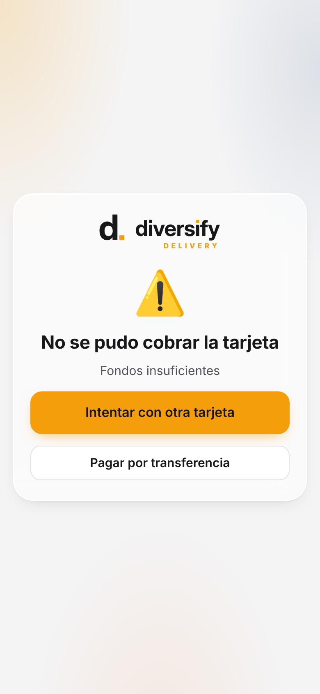
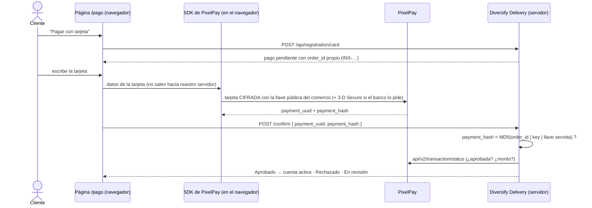

# Cobro de la inscripción con PixelPay

La inscripción de los clientes es un **pago único de US$5** (se cobra en lempiras al tipo de cambio de Ajustes, o
en dólares si el comercio lo tiene habilitado). Se paga con tarjeta por **PixelPay** o por transferencia.

| Pago con tarjeta | Aprobado | Rechazado | En revisión (panel) |
|---|---|---|---|
|  |  |  |  |

## Cómo funciona



- **Los datos de la tarjeta nunca llegan a nuestro servidor.** El SDK oficial (`@pixelpay/sdk-core` 2.5.10, MIT,
  alojado en `wwwroot/js/vendor/pixelpay-sdk.js`) los cifra en el navegador y los manda directo a PixelPay. La
  prueba automática revisa que ninguna petición a nuestro servidor lleve el número de tarjeta.
- **La llave secreta nunca sale del servidor.** Al navegador va la *Key ID* y el MD5 de la llave secreta, que es
  lo que el SDK necesita (así lo diseñó PixelPay). Con la llave secreta el servidor verifica `payment_hash`.
- **Doble verificación:** hash válido **y** PixelPay confirma que la transacción está aprobada (y por el monto
  correcto). Si PixelPay no responde o no lo indica, el pago queda **En revisión**: el master lo confirma en el
  portal de PixelPay y lo aprueba en *Clientes e inscripciones*.
- Cada intento usa un `order_id` distinto (`INS-<cliente>-<fecha>-<aleatorio>`); una transacción no se puede
  usar dos veces.
- **CSP:** solo la página `/pago/` permite conectarse a PixelPay y a Cardinal Commerce (3-D Secure) y mostrar la
  verificación del banco en un marco. El resto del sitio sigue con la política estricta de siempre.

## Configuración en el servidor

En `/etc/diversify-delivery/delivery.env` (los datos salen del portal de PixelPay del comercio):

```ini
PixelPay__Endpoint=https://pixelpay.app      # o la URL que PixelPay asigne al comercio
PixelPay__Key=key-id-del-comercio
PixelPay__SecretKey=llave-secreta-del-comercio
PixelPay__Currency=HNL                       # USD solo si el comercio cobra en dólares
```

Luego `systemctl restart diversify-delivery`. Con PixelPay configurado, la pasarela simulada desaparece.
En producción la app no arranca si `PixelPay__Sandbox=true` o si falta la llave secreta.

## Probar con el sandbox de PixelPay (desde tu computadora)

El sandbox (`pixelpay.dev`) tiene una verificación de Cloudflare que bloquea el tráfico automático desde
servidores en la nube, así que **no se pudo probar aquí**. Pruébalo desde tu computadora:

1. `PixelPay__Sandbox=true dotnet run --project src/Diversify.Delivery --launch-profile http`
2. Abre http://localhost:5390, crea una cuenta y elige **Tarjeta**. Debe decir "Modo de prueba (sandbox)".
3. Paga con una tarjeta de prueba de PixelPay (las publica PixelPay en su documentación del sandbox; la Visa de
   prueba habitual es `4111 1111 1111 1111`, vencimiento futuro, CVV `999`).
4. Revisa que la cuenta quede **Activa** y que el pago aparezca en el portal de prueba de PixelPay.

Si el paso 4 falla con "PixelPay no indicó si la transacción fue aprobada", el formato de la consulta de estado es
distinto al que usa el SDK: el pago queda en revisión (no se pierde) y hay que ajustar `PixelPayService.GetStatusAsync`
con la respuesta real.

## Pruebas automáticas

`tests/pago-pixelpay.cjs` usa el **SDK oficial en el navegador** contra `tests/pixelpay-simulado.cjs` (mismas rutas
y formato que PixelPay): pago aprobado, rechazado y reintento, estado sin confirmar, `payment_hash` falso y CSP.

## Pendiente

- Probar con el sandbox real y luego con las credenciales de producción del comercio.
- Confirmar con PixelPay el formato exacto de `api/v2/transaction/status` (se tomó del SDK).
- Aviso del resultado de PixelPay al servidor (`order_callback`) como respaldo si el cliente cierra la página justo
  después de pagar. Hoy, ese caso se resuelve revisando el portal de PixelPay.
