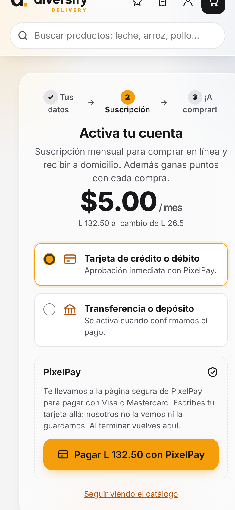
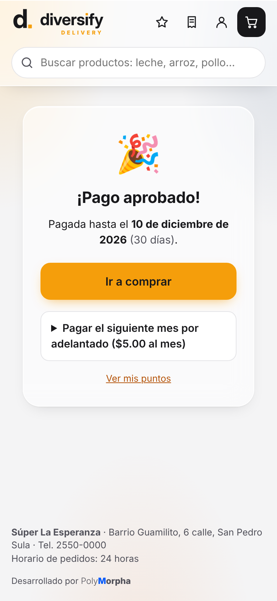
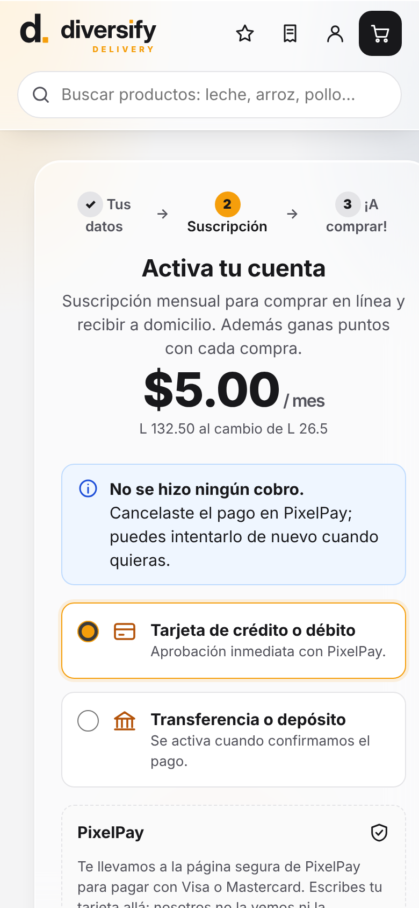
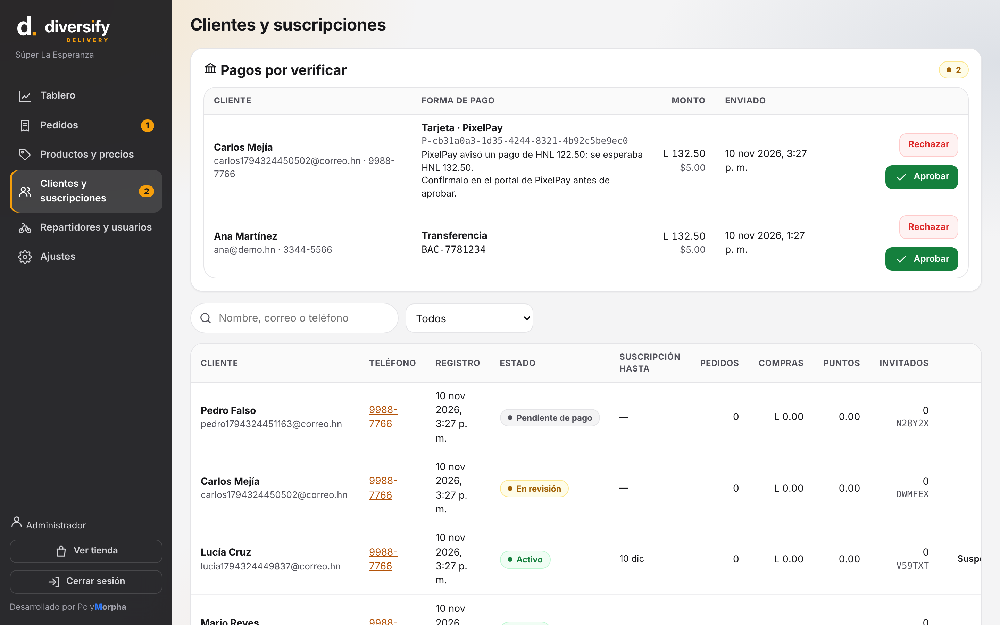
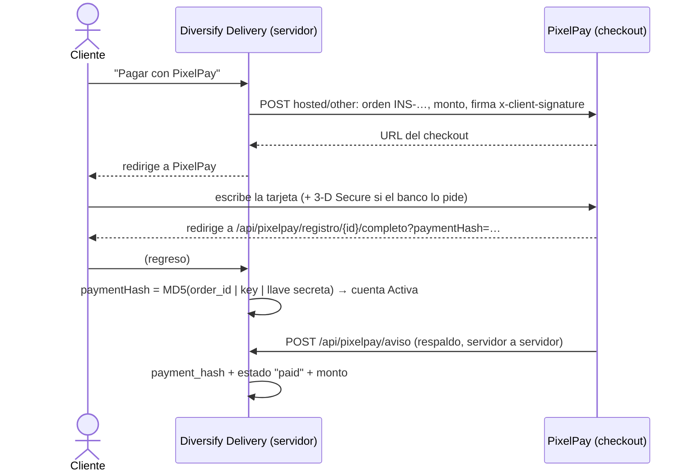

# Cobro de la suscripción con PixelPay

La suscripción de los clientes es de **US$5 al mes** (se cobra en lempiras al tipo de cambio de Ajustes, o en
dólares si el comercio lo tiene habilitado). Se paga con tarjeta por **PixelPay** o por transferencia. Cada pago
aprobado suma un mes (ver [Decisión 006](../notas/Decisiones/006%20Suscripcion%20mensual%20y%20puntos.md)). El
número de orden empieza con `SUS-`.

**Cobro automático:** hoy cada mes se paga a mano. PixelPay ofrece "Cobros recurrentes" (API en beta,
`api/v2/subscriptions`, recurrencia mensual y webhook por cada cobro). Para usarlo, el aviso de cada cobro debe
llamar a `Subscriptions.Extend`, igual que hoy.

La integración es **Hosted Payment**: el cliente escribe la tarjeta en la página de pago de PixelPay, no en la
nuestra. Es lo que recomienda la documentación oficial de PixelPay cuando el comercio no quiere manejar datos de
tarjeta (ver [Decisión 005](../notas/Decisiones/005%20PixelPay%20Hosted%20Payment.md)).

| Antes de ir a PixelPay | Pago aprobado | Canceló en PixelPay | Monto distinto (panel) |
|---|---|---|---|
|  |  |  |  |

## Cómo funciona



- **Los datos de la tarjeta nunca pasan por esta app.** Ni el navegador de nuestra tienda ni el servidor los ven.
  3-D Secure lo resuelve PixelPay en su página.
- **La llave secreta nunca sale del servidor.** Con ella se firma cada orden (`_client_signature` y la cabecera
  `x-client-signature`: HMAC **SHA3-512** de `key|order_id|endpoint`, como pide la guía
  "Firma de Seguridad" de PixelPay) y se verifica `payment_hash`.
- **El monto lo fija el servidor**, al crear la orden servidor a servidor. El navegador no lo puede cambiar.
- **Dos vías de confirmación:** el regreso del cliente (`_complete`, con `paymentHash`) y el aviso de PixelPay
  (`_callback`). Si el cliente cierra la ventana justo después de pagar, el aviso activa la cuenta igual.
  Si el aviso trae un monto o moneda distinta, el pago queda **En revisión** con el motivo, y el master lo
  confirma en el portal de PixelPay.
- Cada intento usa un `order_id` distinto (`INS-<cliente>-<fecha>-<aleatorio>`). Si el cliente cancela en
  PixelPay vuelve a la inscripción sin cobro y puede reintentar.
- **CSP estricta en todo el sitio**: no se carga ningún script de PixelPay.

Rutas propias (sin sesión; las protege `payment_hash`, que solo PixelPay y nosotros podemos calcular):

| Ruta | Quién la llama |
|---|---|
| `GET /api/pixelpay/registro/{id}/completo?paymentHash=` | El navegador del cliente, redirigido por PixelPay al aprobarse |
| `GET /api/pixelpay/registro/{id}/cancelado` | El navegador del cliente, al tocar "Cancelar y regresar" |
| `POST /api/pixelpay/aviso` | PixelPay (webhook). Debe ser público: no ponerlo detrás de Cloudflare Access |

## Configuración en el servidor

En `/etc/diversify-delivery/delivery.env` (los datos salen del portal de PixelPay del comercio, **Preferencias →
Opciones del API**):

```ini
App__PublicUrl=https://delivery.diversify.hn  # lo pone el instalador; PixelPay devuelve al cliente aquí
PixelPay__Endpoint=https://pixelpay.app       # el dominio que aparece en la barra del portal del comercio
PixelPay__Key=key-id-del-comercio
PixelPay__SecretKey=llave-secreta-del-comercio
PixelPay__Currency=HNL                        # USD solo si el comercio cobra en dólares
```

Luego `systemctl restart diversify-delivery`. Con PixelPay configurado, la pasarela simulada desaparece.
En producción la app **no arranca** si `PixelPay__Sandbox=true`, si falta la llave secreta, si `App__PublicUrl`
no es `https://…` o si el sistema no soporta SHA3-512 (OpenSSL 1.1.1 o más reciente; Debian 12 lo trae).

## Probar con el sandbox de PixelPay (desde tu computadora)

Desde los servidores en la nube donde se desarrolló esto no se llega al sandbox (Cloudflare lo bloquea), así que
**falta probarlo con PixelPay real**. Desde tu computadora:

1. `PixelPay__Sandbox=true dotnet run --project src/Diversify.Delivery --launch-profile http`
   (usa la ruta `hosted/sandbox` y las llaves públicas de prueba de PixelPay: Key `1234567890`).
2. Abre http://localhost:5390, crea una cuenta y toca **Pagar con PixelPay**: debe abrir el checkout de prueba de
   PixelPay.
3. Elige **Pago exitoso**: debe volver a la tienda con "¡Pago aprobado!" y la cuenta **Activa**.
4. Prueba también **Cancelar orden**: debe volver con "No se hizo ningún cobro".
5. El aviso (`_callback`) no puede llegar a `localhost`; se prueba en el servidor de pruebas (rama `beta`) con su
   dominio público, usando **Ejecutar callback** del sandbox.

Si PixelPay responde "Firma de seguridad inválida", revisa que `PixelPay__Endpoint` sea exactamente el dominio del
portal del comercio (la firma incluye ese valor).

## Pruebas automáticas

`tests/pago-pixelpay.cjs` contra `tests/pixelpay-simulado.cjs` (mismas rutas, campos y firmas que la
documentación de PixelPay): pago aprobado, cancelado, rechazado con reintento, cliente que cierra la ventana (solo
aviso), aviso con monto distinto, `paymentHash` y avisos falsos, y CSP estricta.

## Pendiente

- Probar con el sandbox real y luego con las credenciales de producción del comercio.
- Confirmar con PixelPay el formato exacto del aviso (`_callback`): se tomó de su documentación (`order`,
  `payment_hash`, `status: "paid"`, `amount`, `currency`, `uuid`).
